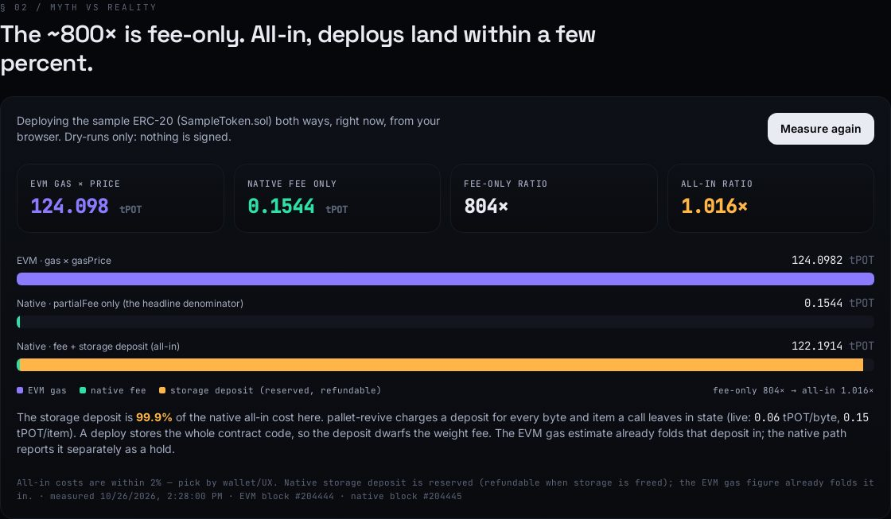
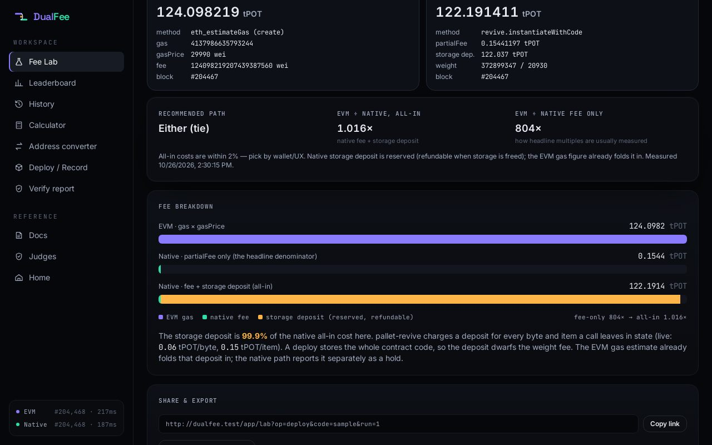
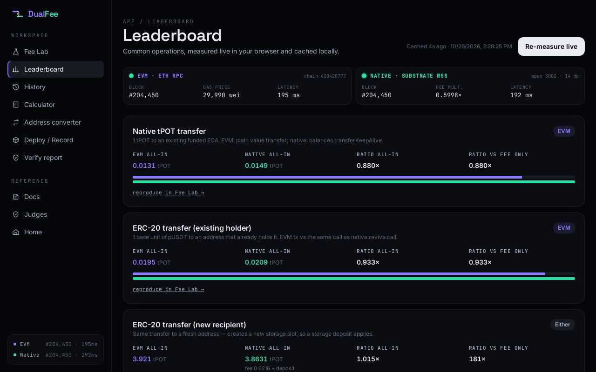
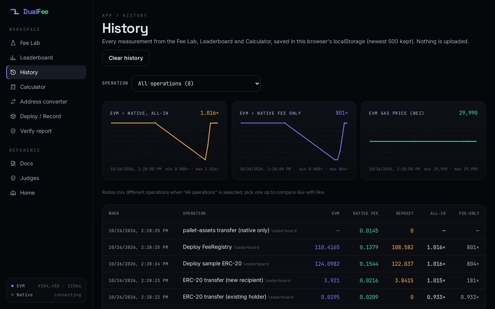
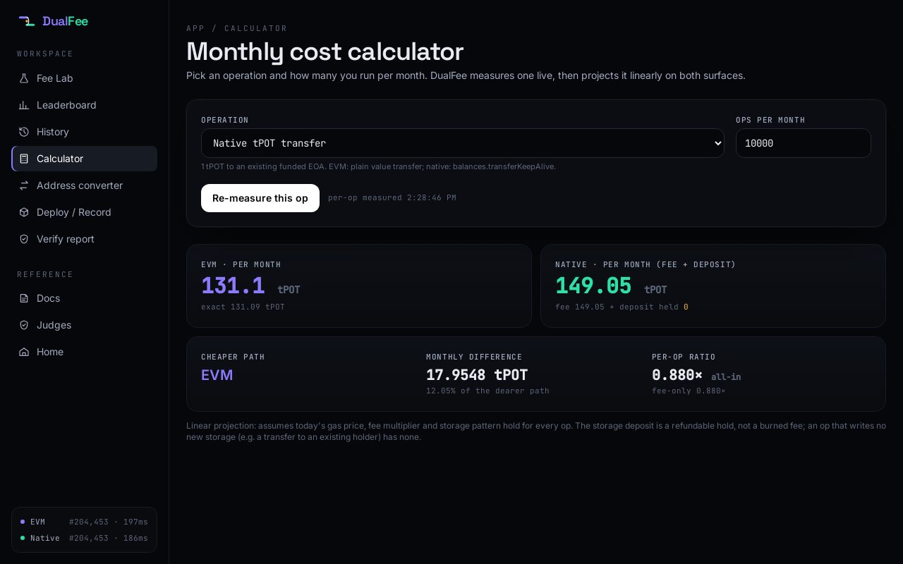
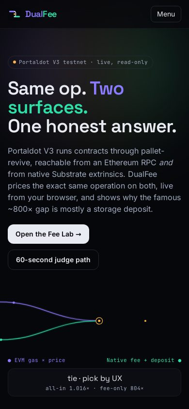
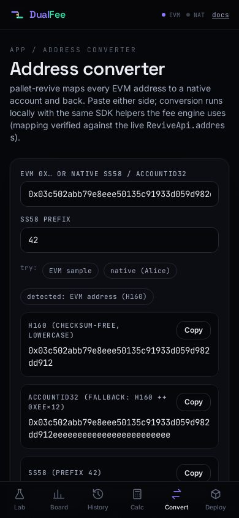
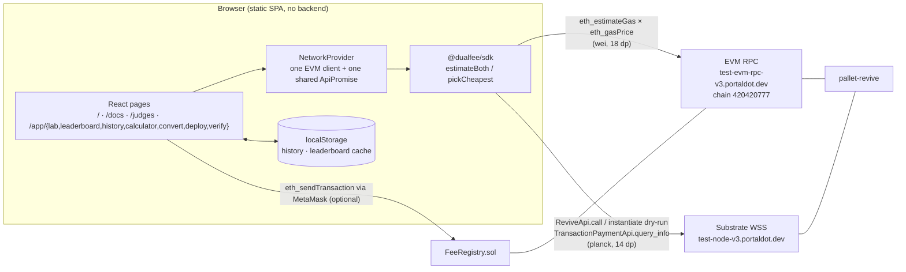

# DualFee

**Same operation, two surfaces: which one is cheaper on Portaldot V3?**

Portaldot V3 runs smart contracts through `pallet-revive`, reachable two ways:

- **EVM surface**: the Ethereum JSON-RPC at `https://test-evm-rpc-v3.portaldot.dev` (chain id `420420777` / `0x190f1ca9`)
- **Native surface**: Substrate extrinsics over `wss://test-node-v3.portaldot.dev`

DualFee asks both surfaces for a **live** estimate of the exact same operation, reconciles the units (14-decimal planck vs 18-decimal wei), and recommends the cheaper path. It's fully client-side and read-only. It holds no keys and has no backend.

> Independent solo build by **Firza Duta Fauzan** ([@dutzozan](https://x.com/dutzozan)). Sibling project: [NodeScope](https://nodescope.vercel.app), node diagnostics for Portaldot V3.

## Why

A fellow Portaldot builder measured a contract deploy at roughly **289 tPOT via EVM vs 0.36 tPOT native (~800×)**. If that held, every deploy should go native. DualFee re-measures it live and shows where the multiple comes from.

### What we measured (live, 2026-10-26 ~13:13 UTC, `npm run measure`)

Runtime: `PortaldotV3 Test`, spec `portaldot-v3` 3002. `tokenDecimals` = 14 (tPOT), `revive.nativeToEthRatio` = 10000, so the EVM uses 18 dp. EVM `eth_gasPrice` was 30045–30050 wei.

| Operation | EVM (gas × price) | Native fee | Native storage deposit | EVM ÷ native **all-in** | EVM ÷ native **fee only** |
| --- | ---: | ---: | ---: | ---: | ---: |
| Native tPOT transfer (1 tPOT) | 0.013109 | 0.014905 | 0 | 0.880× (EVM cheaper) | 0.9× |
| ERC-20 transfer, existing holder | 0.019512 | 0.020909 | 0 | 0.933× (EVM cheaper) | 0.9× |
| ERC-20 transfer, new recipient | 3.921035 | 0.021609 | 3.8415 | 1.015× (tie) | 181.5× |
| Deploy SampleToken (1,414 B) | 124.098219 | 0.154411 | 122.037 | 1.016× (tie) | **803.7×** |
| Deploy FeeRegistry (1,252 B) | 110.416529 | 0.137909 | 108.582 | 1.016× (tie) | **800.6×** |
| pallet-assets transfer | unavailable | 0.014507 | 0 | n/a | n/a |

All values in tPOT.

**Reading it honestly:**

- The ~800× deploy multiple reproduces when you compare EVM gas cost with the native **`partialFee` alone**.
- On pallet-revive, the EVM gas figure already folds in the **storage deposit**. The native path reports the deposit separately, as a reserved hold that's refundable when the storage is freed. Compare like with like (fee + deposit) and deploys come out within about 1.6%.
- For plain transfers and calls that add no new storage, the EVM path was about 7–12% cheaper in this run.
- We don't claim to know which contract produced the original 289 / 0.36 figure. Our contracts are smaller, so the absolute numbers differ while the multiple matches.

That EVM gas folds in the deposit is our inference from the numbers (EVM total ≈ native fee + deposit, to within ~1.6%), not something we read in docs.

## Features

Live at **https://dualfee.vercel.app**. Multi-page app; every number is read live from the two Portaldot V3 endpoints or from your own earlier measurements in localStorage, never mocked.

| Route | What it does |
| --- | --- |
| `/` | Landing: animated hero where the EVM and Native paths converge into one live answer (the sample deploy is measured as soon as both surfaces answer), live ticker (block, gas price, fee multiplier, latency on both surfaces), Problem → **Myth vs reality** (stacked bar: EVM gas vs native fee vs fee + storage deposit, count-up ratios) → How it works → Features → CTA. |
| `/app/lab` | **Fee Lab**: native transfer, ERC-20 transfer, contract deploy (SampleToken / FeeRegistry / custom bytecode) or raw calldata. Both live estimates side by side, the fee-vs-deposit breakdown, a **share link** that reproduces the measurement (`/app/lab?op=deploy&code=sample&run=1`) and **Export report** (JSON + SHA-256 stamp). |
| `/app/leaderboard` | Six common ops measured live in your browser, cached with a timestamp, each with a compact fee/deposit bar and a "reproduce in Fee Lab" link. |
| `/app/history` | Every measurement (Lab, Leaderboard, Calculator, landing) saved to localStorage (newest 500). Line charts of the all-in ratio, the fee-only ratio and EVM gas price over time, per-op filter, table, **Clear history**. |
| `/app/calculator` | Op + ops/month → monthly cost on each surface from one live measurement, the cheaper path, the difference, and how much of the native cost is a refundable deposit hold. |
| `/app/convert` | Address converter: EVM `0x` H160 ↔ AccountId32 ↔ SS58 (prefix 42 by default) with pallet-revive's mapping rules, validation and copy buttons. |
| `/app/deploy` | Deploy `FeeRegistry.sol` and record a comparison on-chain through **your injected wallet**. DualFee holds no keys. |
| `/app/verify` | Paste/upload an exported report; the stamp is recomputed and any edit is flagged. (Integrity, not a signature.) |
| `/docs` | Methodology, formulas, units (live decimals and deposit constants), why the deposit dominates, calculator and report formulas, limits, sources. |
| `/judges` | The 60-second path. |

Old v0.1 paths (`/lab`, `/leaderboard`, `/deploy`) redirect to their `/app/*` equivalents.

**Under the hood**

- **One shared connection.** A `NetworkProvider` above the router opens the EVM RPC and a single Substrate `ApiPromise` at boot (while the splash is showing) and every route and estimate reuses it, so a cold `/app/leaderboard` no longer opens its own WebSocket. Per-surface status (block, gas price / fee multiplier, round-trip latency, WSS handshake time) refreshes every 12 s while the tab is visible.
- **No silent disabled buttons.** Until both surfaces answer, measure buttons read "Connecting to EVM + Native…" (or whichever is still pending) with a spinner.
- **Splash**: branded intro once per session (`sessionStorage`), 1.2–1.8 s, hard cap 2.5 s, an overlay so nothing waits on it, reduced-motion aware.
- **Motion**: framer-motion for reveals, route cross-fades and count-ups; one easing curve; everything off under `prefers-reduced-motion`. Pages are lazy-loaded.
- **SDK** (`packages/sdk`): `estimateBoth(tx)`, `pickCheapest(tx)`, `liveDecimals(api)`, EVM↔native account mapping. See [packages/sdk/README.md](packages/sdk/README.md).
- **FeeRegistry** (`contracts/src/FeeRegistry.sol`): append-only on-chain log of comparisons (hash, op type, both fees, timestamp, `ComparisonRecorded` event).

### Screenshots

Captured from the production build with headless Chromium against the live testnet (2026-10-26).

| Landing | Myth vs reality (live) |
| --- | --- |
|  |  |
| **Fee Lab** | **Leaderboard** |
|  |  |
| **History** | **Calculator** |
|  |  |
| **Mobile (390 px)** | **Address converter (390 px)** |
|  |  |

### Design

Dark technical "dual-surface instrument": violet = EVM, mint = Native, amber is reserved for the storage deposit; Space Grotesk / Inter / JetBrains Mono (all numbers mono, tabular); hairline grid + noise texture. Patterns were borrowed (not copied) from Sui and Navigate (Awwwards SOTD), Cantor8 (CSS Winner SOTD), the MotionSites dark gallery, Linear and Vercel. Details and links: [docs/design-references.md](docs/design-references.md).

## Architecture



How one comparison works:

1. One `DualTx` describes the operation.
2. **EVM leg:** `eth_estimateGas` and `eth_gasPrice`, so fee = gas × price in wei. That's converted to planck by dividing by 10^(evmDecimals − nativeDecimals), truncating dust the same way pallet-revive does.
3. **Native leg:** a `ReviveApi` dry-run with a **storage deposit limit > 0** (a zero or None limit makes revive dry-runs fail) gives `weightRequired` and the storage deposit. Then the real extrinsic (`revive.call` / `revive.instantiateWithCode` / `balances.transferKeepAlive` / `assets.transferKeepAlive`) is weighed with `paymentInfo` to get `partialFee`.
4. **Compare all-in:** fee + deposit on both sides. Results within 2% count as `either`. The fee-only ratio is shown too, so headline multiples can be checked.

Decimals are read at runtime from the chain properties (`tokenDecimals`) and the `revive.nativeToEthRatio` constant. Verified constants are the fallback.

## Run

```bash
npm install
npm run dev        # http://localhost:5173
npm test           # vitest (48): fee math, decimals, ratios, mapping, ABI encoding, calculator, share-URL encoding, report hashing, history
npm run build      # tsc -b && vite build  -> dist/
npm run measure    # prints the live leaderboard numbers from Node
```

Contracts (optional):

```bash
cd contracts && npm install
npx hardhat compile
npx hardhat test   # in-process Hardhat network, no keys
cd .. && npm run compile:contracts   # solc-js -> packages/sdk/src/artifacts.ts
```

`contracts/hardhat.config.cjs` defines a `portaldot` network (chain `420420777`) with **`accounts: []`**. It contains no private keys and reads none. To deploy, use the app's `/deploy` page with your own wallet. This runtime accepts EVM bytecode (`revive.allowEVMBytecode`), so plain `solc` output deploys.

## Deploy (static)

This is a Vite static build that's ready for Vercel: framework *Vite*, build command `npm run build`, output `dist`. `vercel.json` rewrites every path to `index.html` so SPA routes work. There are no environment variables or secrets.

## Honest limits

- **Estimates, not receipts.** Both legs are dry-runs against current state. Real fees move with the gas price, the weight fee multiplier, and state changes (a fresh recipient adds a storage slot, for example).
- **Sample inputs are public testnet data**, found through `eth_getLogs`. The origin `0x03c5…d912` is a funded account. `pUSDT` (`0xe011…dbc2`) is a test token deployed by another builder. The "existing recipient" `0x521d…5b93` is a PortalSwap pair contract, and the EOA `0x11d9…52b7` receives plain value transfers. A dry-run needs an origin that can afford the operation, so a custom `from` with no balance can come back as unavailable.
- **pallet-assets has no verified ERC-20 precompile address** here, so that row's EVM leg is shown as unavailable. We don't guess one.
- **The storage deposit is a hold, not a burn.** It's refundable when the storage is freed. "All-in" counts it because it's tPOT you need up front.
- **No EVM explorer links.** Portaldot's official explorers are Substrate-side, so DualFee never builds an EVM explorer URL from EVM data. Tx hashes are shown as-is.
- **Mobile** was checked at 390 px with headless Chromium (no horizontal overflow on any route), not on a physical device.
- **History is per-browser.** It lives in localStorage; clearing site data removes it.
- **The report stamp is a hash, not a signature.** It proves a report wasn't edited after export, not who exported it.
- **The calculator is linear**: it doesn't model gas-price or fee-multiplier drift within a month.

## Sources

- Portaldot V3 testnet endpoints (above): every number in this README came from them through `npm run measure`.
- Polkadot SDK `pallet-revive` (account mapping `h160 ++ 0xEE×12`, `nativeToEthRatio`, `ReviveApi`). The mapping was checked against the live `ReviveApi.address` runtime call.
- The ~289 vs 0.36 tPOT (~800×) deploy figure was reported by another Portaldot Hacker House builder. We credit it and re-measure it; we didn't reproduce their exact contract.

## References

- Design: [docs/design-references.md](docs/design-references.md) (Sui, Navigate, Cantor8, MotionSites, Linear, Vercel).
- Methodology and formulas: [`/docs`](https://dualfee.vercel.app/docs).

## License

MIT © 2026 Firza Duta Fauzan
